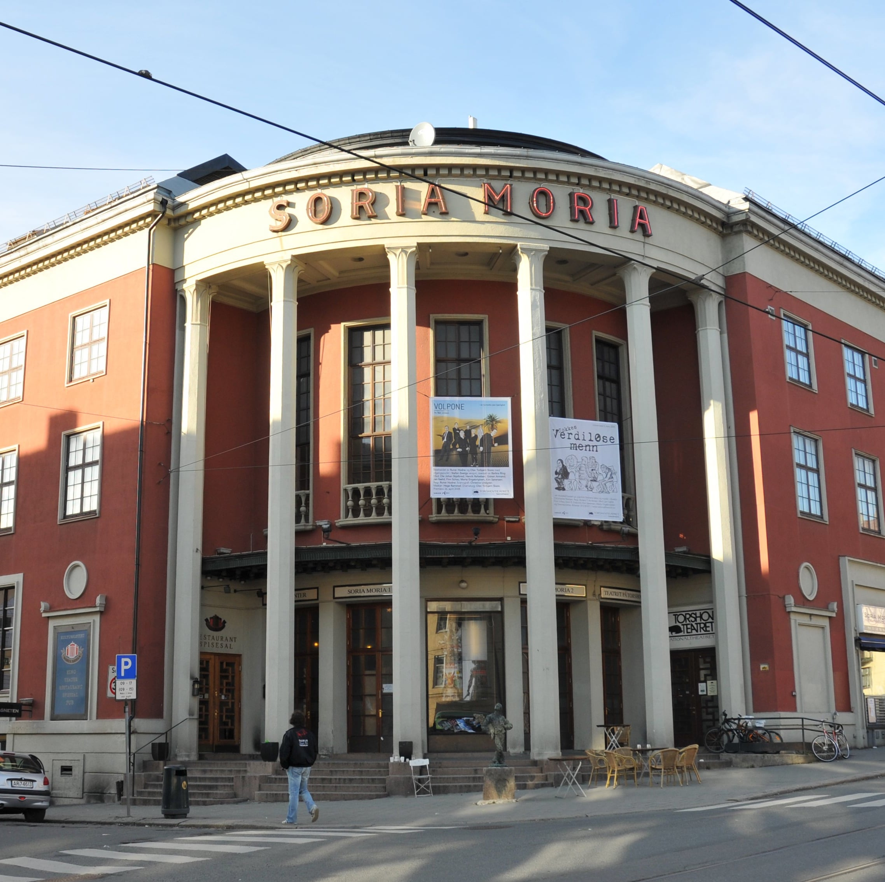
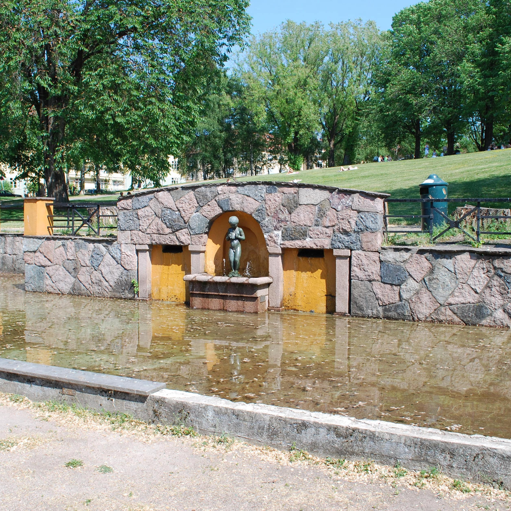
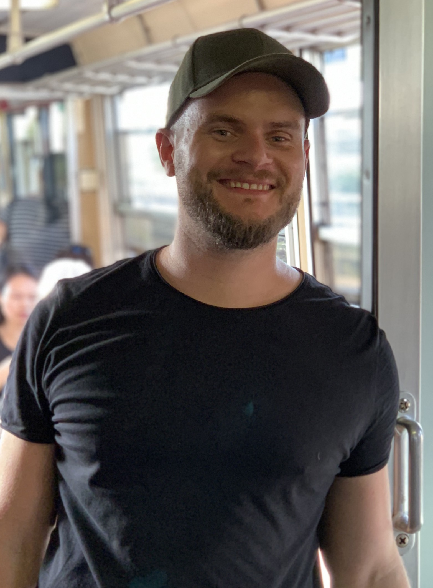

# Hometown Homepage 代码评审报告

## 总评

这个项目作为 Scrimba《HTML & CSS》课程的独立练习，完成度很好，先说值得肯定的地方。页面结构分区清晰，index.html:8/14/45 用 HERO / ACTIVITIES / GUIDE 三段注释划分区块，class 命名见名知意（head-section、activity-section、card-wrapper、info-card）；全站只用 Flexbox 布局，hero 区用 flex 三件套居中，没有绝对定位和浮动，手法干净现代；文件头部还记录了带来源链接的五色调色板（styles.css:1-9），已经具备设计 token 的意识；配色贯彻一致，三张卡片节奏统一，整体视觉还原度很高。主要提升空间集中在三个层面：一是页面元信息（viewport、title、lang）尚未声明，移动端会按约 980px 桌面视口渲染，屏幕阅读器与搜索引擎也读不到页面主题；二是 CSS 层硬编码较多，颜色、px 字号、id 选择器各自为政，调色板注释尚未落地成变量；三是全文件尺寸按桌面端写死，媒体查询待添加，400px 的 guide 卡与约 870px 的卡片行在手机上必然横向溢出。总体定位：这是一份视觉还原优秀、基础扎实的新手作品，距「工程美」还差三层台阶，分别是语义层、token 层、响应式层，三层台阶的走法都写在下面的建议与路线图里。

## 做得好的地方

1. 结构清晰、命名规范。index.html:8/14/45 用 HERO / ACTIVITIES / GUIDE 注释划分三个区块，一眼看清页面骨架；class 命名见名知意（.head-section、.activity-section、.card-wrapper、.card、.info-card），按组件分组，读起来很轻松。
2. 标题纪律好。index.html:10 全页只有一个 h1「Visit Torshov」，符合单主标题原则。
3. 装饰图处理正确。styles.css:26 把 hero 大图放在 CSS background 而非 img 标签，装饰图放在背景层，语义层保持干净，alt 处理可以省去，这是对的做法。
4. 内容图预留了语义挂载点。index.html:19/27/35 三张活动图用 img 标签承载而非背景图，为补充 alt 留好了正确位置。
5. 有 token 意识。styles.css:1-9 把设计稿五个颜色集中记录并附来源链接，这是变量化改造的最佳起点。
6. 布局手法统一现代。全站只用 Flexbox：.head-section 的 flex 列居中（styles.css:29-32）、.card-wrapper 的 space-evenly（styles.css:66-67）、.guide-section 的 align-items:center（styles.css:91-92），桌面端三张卡片均匀分布，没有用绝对定位或浮动 hack。
7. 细节有设计意识。标题块用背景色加圆角保证在照片上可读（styles.css:37-41）；卡片有阴影层次（styles.css:77）；三张卡片 20px padding / 20px margin 节奏一致；guide 区白色文字配 #1D3557 底，对比度约 12:1，可读性优秀。
8. 文案真实有信息量。卡片文案是真实内容而非占位文本，info-text 的引语保留了引号（index.html:51），avatar 主动写了 alt（index.html:47），说明已有可访问性意识，文案质量还可以再打磨。

## 改进建议

### 高优先级

1. head 元数据补齐（涉及维度：HTML 语义与可访问性、响应式）

位置：index.html:3-5

现状：head 目前只包含一行样式表链接。viewport 声明待补，移动端浏览器会按约 980px 桌面视口渲染再整体缩小，文字小到需要手动放大；title 待补，标签页只显示文件名，屏幕阅读器用户无法通过标题列表识别页面；html 元素的 lang 属性待补，屏幕阅读器会用系统默认语言朗读英文内容导致发音错误（WCAG 3.1.1 Level A）。另外 charset 与 description 待补，加入非 ASCII 字符时可能乱码；favicon 缺失会产生一次 404 请求。

改进方案：把六项元数据一次补齐，viewport 放在样式表链接之前，html 标签直接写 lang="en"。

```html
<html lang="en">
    <head>
        <meta charset="UTF-8">
        <meta name="viewport" content="width=device-width, initial-scale=1.0">
        <meta name="description" content="Visit Torshov, culture and sports in a vibrant district of Oslo.">
        <title>Visit Torshov, Hometown Homepage</title>
        <link rel="icon" href="images/per.jpg">
        <link rel="stylesheet" href="styles.css">
    </head>
```

2. 三张活动图补充 alt（涉及维度：HTML 语义与可访问性、视觉设计）

位置：index.html:19/27/35

现状：三张 .img-activity 标签只写了 class 与 src，屏幕阅读器会朗读文件名 park.jpg 等，活动信息对盲人用户完全缺失。

改进方案：每张图加一句简短描述性 alt，文案直接写描述内容即可。下面示例里的 src 已经按第 3 条建议对调，alt 与最终图片保持一致。

```html



```

3. 卡片图文对调（涉及维度：HTML 语义与可访问性）

位置：index.html:19-23 与 27-31

现状：第 1 张卡标题讲剧院（Attend a show or a concert）配的却是 park.jpg，第 2 张卡讲公园配的却是 theatre.jpg，图文对不上；第 3 张 sports.jpg 与文案匹配。

改进方案：交换前两张卡的 src，标题与正文保持原样。

```html
<!-- 卡 1 -->

<!-- 卡 2 -->

```

4. 窄屏溢出与响应式兜底（涉及维度：响应式、CSS 架构）

位置：styles.css:65-68 .card-wrapper、90-99 .guide-section、25-34 .head-section

现状：.card-wrapper 三张 250px 卡片加各自 margin 总宽约 870px，flex 不换行，在 375px 手机上必然横向溢出；.guide-section 写死 width: 400px，在 375px 视口下溢出 25px；.head-section 固定 600px 高，background-position 保持默认左上锚定，横图 cover 后主体可能被裁掉。全文件尺寸按桌面端写死，媒体查询待添加；viewport 补上后，这些溢出会立刻暴露。

改进方案：card-wrapper 改用 grid auto-fit 自动换行，间距交给 gap；guide 卡宽度用 min() 限幅，480px 以下改纵向排列；hero 高度用 clamp 弹性收缩并显式居中裁切。

```css
.card-wrapper {
    display: grid;
    grid-template-columns: repeat(auto-fit, minmax(240px, 1fr));
    gap: 24px;
    padding: 0 16px;
}
/* .card 里的 margin: 20px 可以删除，间距已由 gap 承担 */

.guide-section {
    width: min(400px, calc(100% - 32px));
    flex-wrap: wrap;
    justify-content: center;
}
@media (max-width: 480px) {
    .guide-section { flex-direction: column; }
}

.head-section {
    min-height: clamp(320px, 60vh, 600px);
    background-position: center;
}
```

5. 字体系统从零建立（涉及维度：CSS 架构、视觉设计）

位置：styles.css:60/85 的 font-size、styles.css:11-17 body

现状：字号全部用 px（24px、18px），全站 font-family 尚未声明，渲染使用浏览器默认字体（macOS 上会显示成衬线字体，与设计稿观感差异大）。px 字号不跟随浏览器「文字大小」设置，用户开启大字模式时页面纹丝不动，属于可访问性缺陷；正文行高也未显式设置，多行段落偏挤；字号层级是浏览器默认与手写值的拼凑，没有统一的刻度。

改进方案：在 body 上声明系统字体栈与基础字号，标题字号改为 rem（1rem=16px），行高按标题 1.2 / 正文 1.5 设定，并在 :root 里形成一套字号变量。对课程练习来说，系统字体栈已经足够；想更活泼可以后续加载 Google Fonts 的展示字体，用 system-ui 兜底。

```css
:root {
    --fs-xl: 2rem;      /* 32px，主标题 */
    --fs-lg: 1.5rem;    /* 24px，区块标题 */
    --fs-md: 1.125rem;  /* 18px，卡片标题 */
    --fs-sm: 1rem;      /* 16px，正文 */
    --lh-heading: 1.2;
    --lh-body: 1.5;
}

body {
    font-family: system-ui, -apple-system, "Segoe UI", Roboto,
                 "Helvetica Neue", Arial, sans-serif;
    font-size: var(--fs-sm);
    line-height: var(--lh-body);
}
h1, h2, h3 { line-height: var(--lh-heading); }
#activity-title { font-size: var(--fs-lg); }
.card-title      { font-size: var(--fs-md); }
```

6. 卡片 hover 状态重新设计（涉及维度：视觉设计、CSS 架构、响应式）

位置：styles.css:80-82 .card:hover

现状：悬停时背景变 #7a5daa 而文字仍是深蓝 #1D3557，实测对比度仅 2.34:1，远低于 WCAG AA 的 4.5:1，悬停时文字难以辨认；#7a5daa 不在文件头部声明的调色板内；状态变化在瞬时完成，显得生硬；卡片只有 hover 态，键盘用户没有对应反馈；移动端无 hover，点击后紫色背景会粘住不退。

改进方案：换用调色板内颜色做 hover 并同步切换文字色，加 0.2s 过渡，补上 :focus-visible 让键盘用户看到同样反馈，再用 @media (hover: hover) 把悬停态限定在真指针设备上。

```css
.card {
    transition: background-color 0.2s ease, color 0.2s ease;
}
@media (hover: hover) {
    .card:hover,
    .card:focus-visible {
        background-color: #457B9D;
        color: #F1FAEE;
    }
}
```

### 中优先级

1. 页面骨架升级为语义标签（涉及维度：HTML 语义与可访问性）

位置：index.html:9/15/46

现状：head-section、activity-section、guide-section 三个页面级区块全部用 div 承载，屏幕阅读器和搜索引擎识别不到页面骨架。

改进方案：hero 用 header，活动区用 main 包 section，每张卡用 article（卡片标题升为 h3），guide 卡用 footer。class 名全部保留，样式选择器可以保持原样。

```html
<header class="head-section">...</header>
<main>
    <section class="activity-section" aria-labelledby="activity-title">
        <h2 id="activity-title">Top three activities to do at Torshov</h2>
        <div class="card-wrapper">
            <article class="card">
                
                <h3 class="card-title">Attend a show or a concert</h3>
                <p>The Torshov Theatre is a great place to spend your night out.</p>
            </article>
            <!-- 其余两张卡同理 -->
        </div>
    </section>
</main>
<footer class="guide-section">...</footer>
```

2. 标题层级理顺（涉及维度：HTML 语义与可访问性）

位置：index.html:11/16/50/52

现状：h2 只是视觉副标题而非章节标题；活动标题 h3 在副标题改掉后会变成 h1 到 h3 跳级；guide 区 h3（Your guide）与 h4（人名）混用，人名其实不是标题；.info-title 同一样式挂在两个层级上，语义不实。

改进方案：副标题改 p，活动标题升 h2，Your guide 用 h2，人名改 p；样式选择器对应调整，人名加 font-weight: bold 保持外观。

```html
<p id="subtitle">Enjoy culture and sports in this vibrant district close to the center of Oslo.</p>
<h2 id="activity-title">Top three activities to do at Torshov</h2>
<h2 class="info-title">Your guide</h2>
<p class="info-name">Per Harald Borgen</p>
```

```css
.info-name { font-weight: bold; }
```

3. 手工换行交给 CSS（涉及维度：HTML 语义与可访问性、响应式）

位置：index.html:11/21-23/29-31/37-39

现状：副标题和卡片正文用 <br> 手工断行，换行位置固定，窄屏下会出现生硬断裂，且屏幕阅读器会在句子中间停顿、打断朗读节奏。副标题第一行约 500px 的硬行在 320 到 400px 屏上会撑破背景色块。

改进方案：把全部 <br> 删除，让文字自然换行，用 max-width 控制行长，布局交给 CSS。

```css
#subtitle { max-width: 420px; }
.card p { max-width: 160px; margin-inline: auto; }
```

4. 调色板落地为变量，圆角刻度统一（涉及维度：CSS 架构、视觉设计）

位置：styles.css:1-9 与 37/46/54/71/93/97/102 等

现状：头部注释列了 5 个颜色，但正文全部硬编码，仅 #1D3557 就出现 6 次，注释与代码脱节，改主题色要全局搜索替换。圆角并存 5 种刻度：5px（标题条）、10px（卡片）、8px（guide）、30px（头像）、50%（活动图）。

改进方案：把注释落地为 :root 自定义属性，颜色名沿用注释里的语义名；圆角定义三个 token，50% 圆形作为唯一例外保留。

```css
:root {
    --color-red: #E63946;
    --color-light: #F1FAEE;
    --color-aqua: #A8DADC;
    --color-light-blue: #457B9D;
    --color-dark-blue: #1D3557;

    --radius-s: 8px;   /* 标签、标题条 */
    --radius-m: 12px;  /* 卡片、guide 卡 */
    --radius-l: 24px;  /* 头像 */
}
.card { color: var(--color-dark-blue); border-radius: var(--radius-m); }
```

5. 样式选择器从 id 改为 class（涉及维度：CSS 架构）

位置：styles.css:36 #title、44 #subtitle、59 #activity-title

现状：三个标题都用 id 选择器写样式，特异性 1-0-0，复用成本高；id 每个页面只能出现一次，想复用同款标题样式必须复制声明或改 HTML；id 更适合留给锚点跳转和 JS 钩子。

改进方案：改为语义化 class，按 BEM 思路命名（.hero__title / .hero__subtitle / .activities__title），HTML 里的 id 删除或仅保留无样式的 id。

```html
<h1 class="hero__title">Visit Torshov</h1>
<p class="hero__subtitle">Enjoy culture and sports...</p>
```

```css
.hero__title { ... }
.hero__subtitle { ... }
```

6. 重复声明抽取共享类（涉及维度：CSS 架构）

位置：styles.css:36-50、53-56、101-103

现状：#title 与 #subtitle 重复 padding: 4px 20px / border-radius: 5px / text-shadow 三条声明；color: #1D3557 在 4 个选择器里各自声明，本可由 activity 区父级继承；0px 0px 1px 可以简写为 0 0 1px；现有 text-shadow 0 0 1px black 只有 1px 模糊，视觉上几乎看不见，可顺带加强。

改进方案：公共视觉抽成共享类或分组选择器；继承色交给 .activity-section 一处声明，子元素写 color: inherit 或直接不写；零值省略单位；text-shadow 一并升级为半透明柔影。

```css
.hero__title,
.hero__subtitle {
    padding: 4px 20px;
    border-radius: var(--radius-s);
    text-shadow: 0 1px 2px rgba(0, 0, 0, 0.4);
}
.hero__title    { background: var(--color-light-blue); }
.hero__subtitle { background: var(--color-dark-blue); }

.activity-section { color: var(--color-dark-blue); }
```

7. 盒模型重置补到文件顶部（涉及维度：CSS 架构）

位置：styles.css:70-78 .card

现状：没有 box-sizing 重置，默认 content-box 下 .card 声明 width: 250px，实际盒宽 290px（加 20px padding 两侧），三张卡约 870px，窗口稍窄就溢出；等将来加 border-box 时所有尺寸会一起变，返工成本更高。

改进方案：在文件最顶部加通用盒模型重置，之后 width 即最终宽度；加完后把 .card 的 width 按最终视觉微调。

```css
*,
*::before,
*::after {
    box-sizing: border-box;
}
```

8. 无效声明清理（涉及维度：CSS 架构、视觉设计）

位置：styles.css:110-114 .info-text、90-99 .guide-section

现状：.info-text 不是 flex 容器，justify-content: space-around 在当前位置不产生效果；text-align-last: center 与 body 的全局居中重复；.guide-section 的 background-size: cover 没有对应背景图，属于死代码。

改进方案：把三处无效属性删除，.info-text 只保留 font-style: italic。

```css
.info-text { font-style: italic; }
```

9. 拼写与标点统一（涉及维度：HTML 语义与可访问性）

位置：index.html:28 与 20/28/36

现状：piknic 一词的拼写应为 picnic；三张卡标题句末标点不一致（前两张无句号、第三张有句号）。

改进方案：改正拼写，三张卡标题句末标点统一为省略句号。

```html
<h3 class="card-title">Go to a picnic in the local park</h3>
<h3 class="card-title">Get sweaty at the sports center</h3>
```

10. body 装饰边框与全局居中收窄（涉及维度：视觉设计、CSS 架构、响应式）

位置：styles.css:11-17 body

现状：白底上的 10px 白边框在白色视口上与背景融为一体，却把可用宽度吃掉 20px，使 guide 卡在窄视口提前溢出；页面滚出第一屏后顶部圆角处会露出白边断层，在深色环境下白框非常突兀；text-align: center 挂在 body 上全局继承，任何新元素默认居中，布局脆弱。

改进方案：把 body 的 border 与 border-radius 删除，只保留 margin: 0；居中下放到各 section（hero 已是 flex 居中，活动标题与卡片补 text-align: center 即可）。

```css
body { margin: 0; }
#activity-title, .card, .guide-section { text-align: center; }
```

11. 图片尺寸与裁切工程化（涉及维度：响应式、视觉设计）

位置：images/ 下 5 张图、styles.css:20-23 .img-activity、116-121 .avatar

现状：活动图只定宽不定高，圆形裁切依赖三张图恰好近似正方形，换图就会变成椭圆，高度不定还会导致加载后布局跳动；sports.jpg 1.8MB、park.jpg 1.2MB，5 张图合计约 5MB 原图只为显示成 100px 小圆；avatar 固定 200×250px，per.jpg 实测 1562×2118（比例约 0.74）与容器比例 0.8 不匹配，人物被横向拉伸约 8%。

改进方案：给活动图补 aspect-ratio 与 object-fit，让圆形裁切与素材解耦；头像只定宽、高度交给原图比例并用 object-fit 兜底；源图压缩到约 400px 宽再引用（可用 sips 手动缩放，或构建时处理）。

```css
.img-activity {
    width: 100px;
    aspect-ratio: 1;
    object-fit: cover;
    border-radius: 50%;
}
.avatar {
    width: 200px;
    aspect-ratio: 4 / 5;
    object-fit: cover;
    border-radius: var(--radius-l);
    padding: 20px;
}
```

### 低优先级

1. avatar alt 文案简化（涉及维度：HTML 语义与可访问性）

位置：index.html:47

现状：alt 文案「self-portrait of Per Harald Borgen, he smiling in the picture」有语法错误（he smiling）和冗余（in the picture），且与相邻文字重复人名。

改进方案：简化为一句描述，alt 文案直接写描述内容。

```html

```

2. 卡片阴影柔化（涉及维度：视觉设计）

位置：styles.css:77 .card

现状：box-shadow: 0px 0px 5px black 用纯黑加小模糊，阴影生硬像描边，缺乏深度层次。

改进方案：改用调色板深蓝的低透明度阴影，下移 2px 让卡片有轻微浮起感。

```css
.card { box-shadow: 0 2px 8px rgba(29, 53, 87, 0.15); }
```

3. guide 卡造型完整化（涉及维度：视觉设计）

位置：styles.css:90-99 .guide-section

现状：只有 border-bottom 且圆角只切顶部，形似被截断的卡片。

改进方案：改为四角圆角加柔和阴影，完成独立名片造型。

```css
.guide-section {
    border-radius: var(--radius-m);
    box-shadow: 0 2px 8px rgba(29, 53, 87, 0.15);
}
```

4. h1 对比度留足余量（涉及维度：HTML 语义与可访问性）

位置：styles.css:36-42 #title

现状：蓝底白字对比度实测 4.59:1，刚过 4.5:1 阈值，若未来缩小字号会不及格。

改进方案：保持 32px 以上的大字号，或把背景换成调色板内更深的 #1D3557（白字对比 12.36:1）。

```css
#title { background: #1D3557; }
```

5. 代码组织加分区注释与属性顺序约定（涉及维度：CSS 架构）

位置：styles.css 全文

现状：正文没有任何分区注释，Hero/Activities/Guide 的样式靠在一起没有导航感；同一选择器内属性顺序不统一（.head-section 里 background 系列和布局混排，.guide-section 里 display 打头而 .head-section 里 display 在中间）；多处双空行。

改进方案：按板块加分区注释，约定属性顺序（布局 display/flex → 盒模型 → 背景视觉 → 文本），空行统一用单个分隔。

```css
/* ===== HERO ===== */
.head-section {
    display: flex;
    flex-direction: column;
    justify-content: center;
    align-items: center;
    min-height: clamp(320px, 60vh, 600px);
    background-image: url("./images/torshov.jpg");
    background-size: cover;
    background-position: center;
}
```

## 工程化改造路线图

### 阶段一：页面骨架与语义

改动文件：index.html（为主）、styles.css（仅配合选择器改名）。

具体改动点：head 补六项元数据（charset、viewport、description、title、favicon、html lang）；div 骨架升级为 header / main > section > article / footer，class 名保留；标题层级理顺（副标题 h2 改 p、活动标题升 h2、Your guide 用 h2、人名 h4 改 p）；三张活动图补 alt 并对调前两张的 src；删除全部 <br>，用 max-width 控制行长；改正 piknic 拼写，句末标点统一。

完成标准：W3C Validator 校验零错误；Lighthouse 可访问性得分 95 以上；页面里 <br> 数量为零，页面级区块全部使用语义标签。

### 阶段二：CSS 变量与命名规范

改动文件：styles.css、index.html（配合类名调整）。

具体改动点：:root 定义颜色、圆角、字号、行高四组变量，正文全部改为 var() 引用；文件顶部加 box-sizing: border-box 重置；body 声明系统字体栈、rem 字号、行高；id 选择器改 BEM 风格 class，HTML 同步；公共声明抽共享类，清理 .info-text 与 .guide-section 的无效属性；hover 重新设计（调色板内颜色、同步切换文字色、0.2s 过渡、补 :focus-visible）；body 装饰边框与全局居中移除，居中下放到各 section。

完成标准：除 :root 外全文无硬编码颜色值；无 id 选择器；无效声明清零；全站文字对比度全部达到 4.5:1 以上。

### 阶段三：响应式与视觉打磨

改动文件：styles.css、images/。

具体改动点：.card-wrapper 改 grid auto-fit 加 gap；.guide-section 宽度改 min() 限幅，480px 以下纵向排列；.head-section 高度改 clamp 弹性收缩，background-position 显式居中；补 mobile-first 断点（480px 两列、768px 三列）；悬停态用 @media (hover: hover) 隔离；活动图补 aspect-ratio 与 object-fit，头像按原图比例裁切；5 张源图压缩到展示尺寸的 2 倍左右（约 400 到 800px 宽）。

完成标准：320px、375px、768px、1024px 四档窗口均无横向滚动条；Lighthouse 性能得分 90 以上；手机实机预览观感与设计稿一致。

建议每个阶段完成后单独做一次 git commit，回退与对比都方便。

## 后续学习建议

1. 先用工具建立量化习惯。用浏览器 DevTools 的 Lighthouse 分别跑移动端与桌面端，记录改造前后的可访问性与性能分数；用 W3C Validator 校验 HTML。看到分数变化，学习反馈会更具体。
2. 对照官方方案复盘。Scrimba 每节课后有参考实现，把自己的代码与参考实现并排比较，重点看布局思路差异，比较完再决定哪种写法更好。
3. 在真机上预览。用手机或 DevTools 设备模拟打开页面，体会 viewport 补上前后、响应式改造前后的实际差异，这是最快建立移动端直觉的方式。
4. 建议的后续练习顺序：先把本页用 Grid 重构一遍（体会 Flex 与 Grid 的分工）；再给页面加一个深色主题（用刚建立的 CSS 变量，体验变量化的红利）；然后挑战带表单的落地页或组件库风格的按钮集，练习 :focus-visible、语义表单与状态管理。
5. 给下一个项目设一条硬性标准：每个页面必须有 viewport、title、lang、alt，让这四件事形成肌肉记忆。
